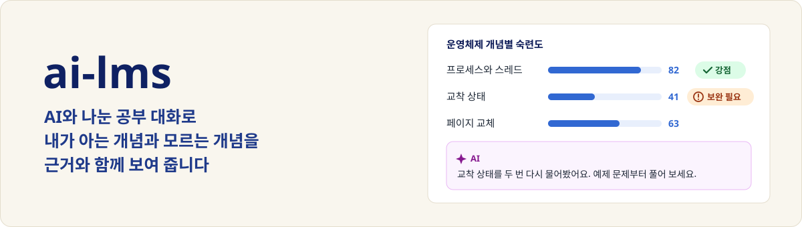
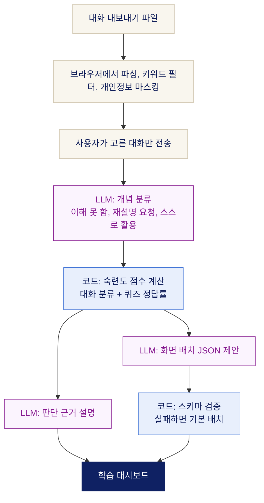

<!-- 영문 README는 준비되면 아래 링크를 다시 연다
<div align="center">
  <strong>KOR</strong> | <a href="README.en.md">ENG</a>
</div>
-->



학습 자료와 ChatGPT, Claude에서 나눈 공부 대화를 분석해 개념별 강점과 보완할 점을 보여 주고,
요약, 퀴즈, 커리큘럼으로 다음에 공부할 순서를 계속 다시 짜 주는 개인 맞춤형 LMS입니다.

<!-- TODO: 시연 영상이 나오면 링크를 연다
[시연 영상 보기 (3분)](https://...)
-->

<!-- TODO: 대표 화면 캡처 (학습 대시보드)

-->

## 왜 만드나요

생성형 AI로 공부하는 대학생을 위한 서비스입니다.

- AI로 공부한 기록은 여러 서비스에 흩어지고, 과목이 끝나면 지워지기 쉽습니다.
- 새 대화를 열 때마다 "나는 이 과목을 이만큼 안다"는 배경 설명을 다시 해야 합니다.
- 공부는 많이 했는데 **무엇을 알고 어디가 부족한지**는 스스로 알기 어렵습니다.

흩어진 학습 기록을 모아 개념별 이해 정도를 보여 주고, 부족한 개념부터 다시 공부할 수 있게 학습 순서를 제안합니다.

<!-- TODO: 설문 결과가 나오면 사례 한 줄 추가 (응답 수가 적으므로 통계가 아니라 사례로 표현) -->

## 시작하는 두 가지 방법

같은 서비스에서 가진 데이터에 따라 시작 경로만 다릅니다.

- **AI 대화 기록이 많다면** ChatGPT, Claude 공식 내보내기 파일을 가져와 바로 분석합니다.
- **AI 대화 기록이 적다면** 학습 자료를 올려 요약과 퀴즈로 시작합니다. 사이트 안의 챗봇과 퀴즈 기록이 쌓이면 같은 방식으로 분석합니다.

## AI는 이렇게 씁니다

파란 칸은 코드가 계산하는 단계, 보라 칸은 AI가 맡는 단계입니다. 서비스 화면에서도 같은 색으로 구분합니다.



| LLM이 하는 일 | LLM이 하지 않는 일 |
| --- | --- |
| 대화에서 개념을 찾고, 이해 수준을 분류 | 숙련도 점수를 매기기 (점수는 명시적 규칙의 코드로 계산) |
| 점수가 나온 근거를 사람이 읽을 수 있게 설명 | 화면 코드를 만들기 (정해진 영역의 순서, 크기, 이유만 JSON으로) |
| 다음에 공부할 순서와 그 이유를 제안 | 원본 대화 파일 받기 (브라우저에서 처리한 결과만 받음) |

- **여러 모델의 독립 판단:** GPT, Gemini, Claude가 같은 기록을 각각 판단한 뒤 결과를 비교하고 통합하는 구조로 설계했습니다. 단일 모델로 먼저 검증하고 모델을 늘려 갑니다.
- **개발에도 AI를 씁니다:** Claude Code로 설계, 구현, 테스트를 진행하고, 사람이 PR 단위로 확인한 뒤 합칩니다.

## 진행 현황

| 기능 | 상태 | 내용 |
| --- | --- | --- |
| 회원가입, 로그인 | 동작 | 가입, 로그인, 로그인 유지, 로그아웃, 내 정보 조회 |
| 공지사항 | 동작 | 목록 API 연결 |
| AI 대화 가져오기 | 로직 구현 | ChatGPT, Claude 파일 파싱, 키워드 필터, 개인정보 마스킹(테스트 완료). 화면은 진행 중 |
| 학습 대시보드 | 목업 데이터 | 개념별 숙련도, 판단 근거, 추천 순서, 배치 JSON 검증 |
| 내 과목 | 목업 데이터 | 과목과 키워드 등록, 수정, 삭제 |
| 학습 자료 업로드 | 목업 데이터 | 과목 선택, 이용 권한 확인, 파일 형식과 크기 검사 |
| AI 분석 (LLM 호출) | 예정 | 개념 분류에서 점수 계산, 대시보드 연결까지 |
| 자료 요약, 퀴즈, 커리큘럼 | 예정 | 화면 자리만 있음 |
| 자료 기반 챗봇 | 예정 | |
| AI 요약 영상 | 준비 중 | |

동작은 실제 API로 동작, 로직 구현은 핵심 로직과 테스트까지 완료, 목업 데이터는 화면은 완성됐고 데이터만 가짜라는 뜻입니다.

[](https://github.com/SpicyShrimpChip/lms/actions/workflows/frontend-ci.yml) [](https://github.com/SpicyShrimpChip/lms/actions/workflows/backend-ci.yml)

프론트 테스트 76개, 백엔드 테스트 56개가 해당 코드가 바뀐 PR마다 GitHub Actions에서 실행됩니다. 백엔드는 H2와 실제 PostgreSQL 16 두 환경에서 같은 테스트를 돌립니다.

## 설계 원칙

- **원본 대화 파일은 서버로 보내지 않습니다.** 브라우저에서 파싱 → 학습 키워드 필터 → 개인정보 마스킹(이메일·전화번호·주민등록번호·카드번호·키·IP·이름)을 거친 뒤, 사용자가 미리보기로 확인하고 고른 대화만 전송합니다. 서버에서도 개인정보 패턴을 한 번 더 검사하도록 설계했습니다.
- **점수는 코드로 계산합니다.** 숙련도는 대화만으로 단정하지 않고 대화 분류 결과와 퀴즈 정답률을 명시적인 규칙으로 계산합니다. 화면에는 항상 판단 근거를 함께 보여 줍니다.
- **LLM은 화면 코드를 만들지 않습니다.** 미리 정의된 영역의 배치 정보만 JSON으로 받고, 스키마 검증을 통과한 경우에만 사용합니다. 실패하면 기본 배치를 씁니다.
- **학습 자료는 올린 본인만 봅니다.** 자료와 그로부터 만든 요약·퀴즈는 다른 사용자와 공유하지 않습니다. 외부 AI에 보낼 때는 학습에 쓰지 않는 API를 씁니다.
- **보안:** 비밀번호는 BCrypt로 저장하고, 로그인 유지 토큰은 사용할 때마다 새로 바꾸며 재사용을 감지합니다. 로그인 시도 횟수를 제한하고, 앱과 테이블 변경용 DB 계정을 분리했습니다. 비밀값은 환경변수로만 관리합니다.

## 기술 스택

        

| 영역 | 기술 |
| --- | --- |
| Frontend | React 19, TypeScript 6, Vite 8, Tailwind CSS 4, React Router 7, TanStack Query 5, Zustand 5, Axios, zod, Motion, Vitest |
| Backend | Spring Boot 3.5, Java 17, Gradle, Spring Security(JWT), Spring Data JPA, Flyway, PostgreSQL 16(Docker), H2(테스트) |
| LLM | 제공사 미정. 여러 모델의 판단을 비교·통합할 수 있는 구조 |
| 개발 환경 | GitHub Actions, ESLint, Prettier, Husky + lint-staged, Renovate, Claude Code |

## 팀

| 역할 | 맡은 일 |
| --- | --- |
| 프론트엔드 | 화면 설계·구현, 대화 파싱·마스킹, 동적 배치 검증, 프론트 CI |
| 백엔드 | API·DB 설계, 인증·보안, LLM 연동, 숙련도 계산, 백엔드 CI |

- **협업 방식:** 기능별 브랜치 → PR → CI 통과 후 `main`에 합칩니다. API처럼 상대 작업에 영향을 주는 변경은 [`docs/frontend-requests.md`](docs/frontend-requests.md)에 정리해 함께 봅니다.

<!-- TODO: 10/28 멘토링에서 받은 피드백과 반영 내용 한두 줄 (반영한 뒤 채운다) -->

## 다음 계획

- **중간 심사까지:** AI 대화 가져오기 화면, 실제 LLM 1개로 개념 분류, 대시보드를 실제 데이터로 연결
- **2단계:** 자료 요약·퀴즈·커리큘럼(대화 기록이 적은 사용자의 시작 경로), 자료 기반 챗봇, 여러 모델 판단 통합
- **이후 후보:** Gemini 대화 가져오기, 이미지 속 글자 마스킹, 약점 변화 추이

## 폴더 구조

```text
.
├── frontend/   React 앱
├── backend/    Spring Boot API
├── docs/       세팅 매뉴얼, 기획 문서, 백엔드 설계, 프론트–백엔드 API 요청
└── .github/    CI 워크플로, Renovate 설정
```

## 로컬 실행

### 화면만 보기 (백엔드 없이)

> Node.js 24가 필요합니다.

```bash
git clone https://github.com/SpicyShrimpChip/lms.git
cd lms/frontend
npm ci
npm run dev   # http://localhost:5173
```

기본 설정은 목업 데이터(`VITE_USE_MOCK=true`)라서 백엔드 없이 모든 화면을 볼 수 있습니다.

<details>
<summary>백엔드까지 실행하기</summary>

> JDK 17과 Docker Desktop이 필요합니다. 새 컴퓨터 세팅 순서와 막힐 때 대처는 [`docs/setup.md`](docs/setup.md), 설계는 [`docs/backend-design.md`](docs/backend-design.md)를 참고하세요.

```bash
cd lms/backend/db
POSTGRES_PASSWORD=<관리자 비밀번호> docker compose up -d   # 처음 한 번: PostgreSQL 컨테이너(lms) 켜기 (PowerShell: $env:POSTGRES_PASSWORD="..."; docker compose up -d)
cd ..
./db/setup-local-postgres.sh # 처음 한 번: DB·계정 만들고 backend/.env 생성 (비밀번호를 물어봐요)
./gradlew bootRun            # http://localhost:8080 (테이블은 Flyway가 자동 생성)
./gradlew test               # H2 메모리 DB로 테스트
./gradlew postgresTest       # 같은 테스트를 로컬 PostgreSQL(ai_lms_test)로 실행
```

- API 문서(Swagger): http://localhost:8080/swagger-ui/index.html
- 비밀값(DB 비밀번호, JWT 시크릿)은 `backend/.env`(커밋 안 됨)에만 둡니다. 형식은 `backend/.env.example` 참고.
- PostgreSQL 없이 띄우려면 `SPRING_PROFILES_ACTIVE=default ./gradlew bootRun` (H2 메모리 DB, 재시작하면 데이터가 사라짐).
- 프론트에서 실제 API로 확인하려면 `frontend/.env.development.local`(커밋 안 됨)에 `VITE_USE_MOCK=false`를 넣습니다.
- `npm ci`를 실행하면 Git 훅도 함께 설치됩니다. 커밋할 때 lint-staged, push할 때 타입 체크가 실행됩니다.

</details>

## 개발 규칙

- 브랜치: `feat/<범위>`, `fix/<범위>`, `chore/<범위>`, `docs/<범위>`
- 커밋: `feat: 학습 대시보드 숙련도 표 추가`처럼 타입 + 한국어 설명
- `main`에는 PR로만 합치고, CI 통과를 확인한 뒤 머지합니다. 리뷰 승인은 필수가 아니며, API처럼 상대 작업에 영향을 주는 변경은 상대방에게 알립니다.
- 프로젝트 규칙과 미결 사항은 [`CLAUDE.md`](CLAUDE.md)에 정리되어 있습니다.
