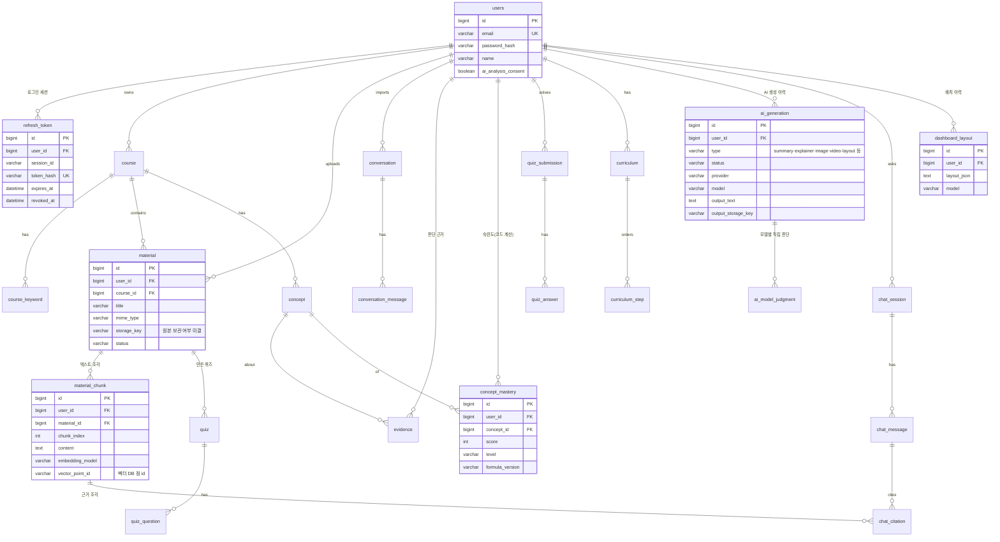

# 백엔드 설계 — DB·인증·확장 구조

최종 수정: 2026-10-25 (회원가입·로그인 구현)

이 문서는 백엔드가 지금 만든 것과, 앞으로 만들 기능이 붙을 자리를 정리한다.
**지금 만든 것**과 **설계만 한 것(아직 테이블·코드 없음)**을 구분해서 읽는다. 설계 부분은 기능을 만들 때 바뀔 수 있다.

## 1. 데이터 저장소 역할

| 저장소 | 상태 | 담는 것 |
| --- | --- | --- |
| **MySQL** (`ai_lms`) | 사용 중 | 회원·인증 세션, 과목, 학습 기록, 숙련도·근거, 커리큘럼, 업로드 파일 메타데이터, 자료 조각(Chunk) 원문, AI 생성 결과 메타데이터, 대시보드 배치. **소유권(누구 데이터인지)의 기준** |
| **벡터 DB** (Qdrant 후보) | 미결 (10/27 멘토링 뒤 결정) | 자료 조각 임베딩, 유사도 검색용 인덱스, 검색 필터용 최소 메타데이터(`user_id`, `material_id`, `course_id`) |
| **파일 저장소** (`global/storage`) | 미구현 | 업로드 원본(보관 여부 미결), AI가 만든 이미지·영상 파일. 로컬 / S3 구현을 인터페이스로 분리 |

- 벡터 DB는 **검색 인덱스일 뿐 원본이 아니다.** 임베딩은 MySQL의 자료 조각에서 언제든 다시 만들 수 있어야 한다.
- 로컬 테스트는 H2(MySQL 모드)도 지원한다. 두 DB에서 모두 돌도록 DB 전용 문법(JSON 타입, 전용 함수)은 쓰지 않는다.

## 2. 지금 만든 테이블 (Flyway `backend/src/main/resources/db/migration`)

| 마이그레이션 | 테이블 | 내용 |
| --- | --- | --- |
| `V1__create_notice.sql` | `notice` | 공지사항 |
| `V2__create_users_and_refresh_token.sql` | `users`, `refresh_token` | 회원, 로그인 세션 |
| `db/seed/R__sample_notices.sql` | (데이터) | 로컬 샘플 공지 3건. **운영(prod) 프로필은 이 폴더를 읽지 않는다** |

- 테이블 구조는 Flyway 마이그레이션 파일로만 바꾼다. 이미 적용된 `V*` 파일은 고치지 않고 새 번호(`V3__...`)를 추가한다.
- Hibernate는 `ddl-auto: validate`로 엔티티와 테이블이 맞는지 검사만 한다.

### `users`

| 컬럼 | 타입 | 설명 |
| --- | --- | --- |
| `id` | BIGINT PK | |
| `email` | VARCHAR(254) **UNIQUE** | 소문자로 저장. 중복은 앱 검사 + DB 제약으로 막는다 |
| `password_hash` | VARCHAR(100) | BCrypt 해시 (원본 저장 안 함) |
| `name` | VARCHAR(30) | |
| `role` | VARCHAR(20) | `USER` |
| `ai_analysis_consent` | BOOLEAN | AI 대화 분석 동의(선택) |
| `ai_analysis_consented_at` | DATETIME(6) NULL | 동의 시각 |
| `terms_agreed_at`, `privacy_agreed_at` | DATETIME(6) | 필수 동의 시각 |
| `created_at`, `updated_at` | DATETIME(6) | |

### `refresh_token`

| 컬럼 | 타입 | 설명 |
| --- | --- | --- |
| `id` | BIGINT PK | |
| `user_id` | BIGINT FK → `users.id` **ON DELETE CASCADE** | 탈퇴하면 세션도 삭제 |
| `session_id` | VARCHAR(36) | 로그인 한 번 = 세션 하나. 회전된 토큰은 같은 값 |
| `token_hash` | VARCHAR(64) **UNIQUE** | 토큰 원문의 SHA-256 (원문 저장 안 함) |
| `expires_at` | DATETIME(6) | |
| `revoked_at` | DATETIME(6) NULL | 회전·로그아웃·재사용 감지로 폐기된 시각 |

## 3. ERD

지금 있는 테이블은 `users`, `refresh_token`, `notice`(관계 없음이라 그림에서 뺌)뿐이고, 나머지는 모두 설계안이다.



### 장기 데이터 → 테이블 대응 (설계안)

| 필요한 데이터 | 테이블 | 메모 |
| --- | --- | --- |
| 사용자 정보 | `users` | 구현됨 |
| 과목·수강 | `course`, `course_keyword` | 프론트 `/courses` API 3번 문서 |
| 학습 기록 | `conversation`·`conversation_message`, `quiz_submission`·`quiz_answer`, `chat_message` | 모두 `user_id` 보유 |
| 업로드 자료 | `material`, `material_chunk` | 원본 보관 여부·지원 형식 미결 |
| 개념별 숙련도 | `concept`, `concept_mastery` | 점수는 코드로 계산, `formula_version`으로 산식 변경 추적 (산식 미결) |
| AI 분석 결과·근거 | `evidence`, `ai_generation`(type=explanation) | 근거는 코드, 설명 문장은 AI. 필드를 섞지 않는다 |
| 맞춤 커리큘럼 | `curriculum`, `curriculum_step` | 순서·이유는 AI, 근거 숫자는 코드 |
| AI 생성 학습자료·이미지·영상 | `ai_generation` | 파일은 `global/storage`, 테이블에는 메타데이터와 저장 키만 |
| 다중 모델 독립 판단·통합 | `ai_model_judgment` | GPT·Gemini·Claude 각각의 판단을 저장하고 통합 결과는 `ai_generation`에. **핵심 차별점이라 구조를 남겨 둔다** |
| 자료 기반 질의응답 | `chat_session`, `chat_message`, `chat_citation` | 답변 근거 조각을 기록 |
| 대시보드 배치 | `dashboard_layout` | `frontend-requests.md` 4번의 저장 제안 그대로 |

## 4. 접근 권한 구조

- **모든 사용자별 데이터 테이블은 `user_id`를 가진다.** 자식 테이블(예: `quiz_answer`)도 조회 경로에서 부모를 거쳐 `user_id`를 확인한다.
- 컨트롤러는 사용자 id를 요청 본문·경로에서 받지 않고 **토큰의 `AuthUser.userId()`만 쓴다** (`@AuthenticationPrincipal AuthUser`).
- 리포지토리 조회는 `findByIdAndUserId(id, userId)`처럼 항상 소유자 조건을 함께 건다. 없으면 403이 아니라 404로 응답해 남의 데이터 존재 여부를 알리지 않는다.
- Spring Security: 공지 조회, `/api/auth/**`(가입·로그인·갱신·로그아웃), Swagger만 공개. 나머지는 로그인 필요. 로그인하지 않으면 없는 주소도 401이다.
- 앱 DB 계정(`ai_lms_app`)은 데이터 읽기·쓰기만 할 수 있고 테이블을 바꿀 수 없다. 테이블 변경은 마이그레이션 계정(`ai_lms_migrator`)만 한다.

## 5. 인증 흐름

| 항목 | 방식 |
| --- | --- |
| 비밀번호 | BCrypt. 규칙은 프론트와 같은 4조건(8자 이상·영문·숫자·특수문자) + BCrypt 한도 72바이트 |
| Access Token | JWT(HS256), 15분, `sub`=사용자 id, `sid`=세션 id. 응답 본문으로 주고 프론트는 **메모리에만** 둔다 |
| Refresh Token | 256비트 난수, 14일, HttpOnly 쿠키(`Path=/api/auth`, `SameSite=Strict`, 운영 `Secure`). DB에는 SHA-256만 |
| 토큰 회전 | 갱신할 때마다 새 Refresh Token 발급, 이전 것 폐기 |
| 재사용 감지 | 폐기된 Refresh Token이 다시 오면 그 세션의 토큰을 모두 폐기 → 같은 세션의 Access Token도 즉시 401 |
| 로그아웃 | 세션 폐기 + 쿠키 삭제. Access Token은 요청마다 세션이 살아 있는지 확인하므로 만료 전이라도 바로 막힌다 |
| CSRF | 인증은 Authorization 헤더라 일반 API는 CSRF 대상이 아니다. 쿠키를 쓰는 `/api/auth/login·refresh·logout`은 `SameSite=Strict` + `X-Requested-With: XMLHttpRequest` 헤더 필수 |
| CORS | 허용 출처는 설정값(`app.cors.allowed-origins`). 개발·배포 모두 같은 출처(프록시·rewrite)라 평소엔 쓰이지 않는다 |
| 반복 로그인 실패 | 같은 이메일+IP 15분에 5회 → 15분 잠금(429), 같은 IP 50회 → 잠금. 메모리 저장(서버 1대 기준) |
| 계정 존재 노출 | 로그인 실패 문구를 하나로 통일, 없는 계정도 BCrypt 비교를 수행해 응답 시간을 맞춘다 (회원가입의 이메일 중복 409는 요구사항상 알린다) |

알려진 한계 (다음 단계에서 다룸)

- 여러 탭이 거의 동시에 갱신하면 한쪽이 재사용으로 판정되어 로그아웃될 수 있다. 프론트는 한 탭 안에서 갱신을 한 번만 보내도록 묶어 두었다.
- 폐기·만료된 `refresh_token` 행을 지우는 정리 작업이 아직 없다.
- 로그인 실패 기록은 메모리에 있어 서버를 여러 대 띄우면 공유되지 않는다(배포 구성 미결).

## 6. 벡터 DB 확장 방식 (설계안, 코드 없음)

### 패키지 자리

```
global/
├── llm/          LlmClient (제공사별 구현 + mock). 여러 모델 독립 판단 → 통합
├── embedding/    EmbeddingClient (임베딩 모델 미결)
├── vector/       VectorStore 인터페이스 — upsert, search(filter), deleteByMaterial, deleteByUser
│                 구현: QdrantVectorStore(후보) / 벡터 DB 없이 시작할 때 MySQL 전문 검색 구현
└── storage/      FileStorage (로컬 / S3)
domain/
├── material/     업로드 → 텍스트 추출 → 조각 나누기(material_chunk) → 임베딩 → VectorStore.upsert
└── chatbot/      질문 → VectorStore.search → MySQL에서 소유권 재확인 → LLM 답변 + chat_citation
```

### ID 연결과 소유권 확인

1. 자료 조각은 **MySQL `material_chunk`에 먼저 저장**하고, 벡터 DB 점(point) id는 `material_chunk.id`(또는 저장한 `vector_point_id`)로 맞춘다.
2. 점의 payload에는 검색 필터용으로 `user_id`, `material_id`, `course_id`, `embedding_model`만 넣는다 (본문·개인정보는 넣지 않는다).
3. 검색은 `user_id = 로그인 사용자`로 필터한 뒤, 돌아온 조각 id로 **MySQL에서 `WHERE id IN (...) AND user_id = :me`로 다시 조회**한다. MySQL에 없거나 소유자가 다르면 버린다. **벡터 DB의 `user_id`는 검색 범위를 줄이는 용도일 뿐 권한 판단에 쓰지 않는다.**

### 삭제 연쇄

| 사건 | MySQL | 벡터 DB | 파일 |
| --- | --- | --- | --- |
| 자료 삭제 | `material` 삭제 → `material_chunk`, 그 자료로 만든 퀴즈·근거 연쇄 삭제 → 숙련도 재계산 | `deleteByMaterial(materialId)` | 원본·생성 파일 삭제 |
| AI 대화 분석 동의 철회 | 대화·대화에서 나온 근거 삭제 → 숙련도 재계산 | 해당 없음(대화는 임베딩하지 않는 안) | - |
| 탈퇴 | `users` 삭제 → 모든 자식 행 `ON DELETE CASCADE` | `deleteByUser(userId)` | 사용자 폴더 삭제 |

- 벡터 DB·파일 삭제는 DB 트랜잭션 밖이라 실패할 수 있다. MySQL에 "지울 것" 작업 행을 같은 트랜잭션으로 남기고(outbox) 재시도하는 방식을 제안한다.

## 7. AI 분석·RAG와의 연결

- **숙련도:** `evidence`(대화 분류 신호·퀴즈 정오) → 점수 계산 클래스(가중치 설정값, 산식 미결) → `concept_mastery`. LLM은 `evidence`와 점수를 받아 설명만 쓴다(`aiExplanation`).
- **다중 모델:** 같은 입력을 여러 `LlmClient` 구현에 보내 각 결과를 `ai_model_judgment`에 저장하고, 통합 규칙(코드)이 최종 결과를 만든다. 모델 수·제공사는 미결이라 설정으로 고른다.
- **RAG 질의응답:** 6번 흐름으로 근거 조각을 찾고, 답변과 함께 `chat_citation`에 근거를 남겨 화면에 출처를 보여 준다.
- **맞춤 설명서·이미지·영상:** 약점 개념 → 관련 조각 검색 → 생성 요청 → `ai_generation`에 상태·모델·결과 위치 저장. 파일은 `global/storage`.
- 모든 AI 호출은 로그인 사용자의 `user_id` 범위 데이터만 입력으로 쓴다.

## 8. 로컬 MySQL 설정

### 이미 만든 DB·계정을 쓰는 경우 (Workbench 등으로 직접 만듦)

```bash
cd backend
./db/configure-local-env.sh   # 두 계정 비밀번호와 JWT 시크릿을 입력 → 접속 확인 → backend/.env 생성
./gradlew bootRun             # 처음 실행할 때 Flyway가 ai_lms에 테이블을 만든다
```

- 이 스크립트는 DB·계정을 만들거나 바꾸지 않는다. 접속 확인용 `SELECT`만 실행한다.
- 일반 DataSource는 `ai_lms_app`, Flyway는 `ai_lms_migrator`를 쓴다 (`application-local.yaml`).
- 처음부터 DB·계정까지 만들 때는 `./db/setup-local-mysql.sh`(관리자 비밀번호 필요)를 쓴다.

### 테스트 전용 DB (`ai_lms_test`)

`./gradlew mysqlTest`는 같은 테스트를 실제 MySQL에서 돌린다. 테스트는 매번 회원·세션 행을 지우므로 **서비스 DB(`ai_lms`)와 분리한 `ai_lms_test`에서만** 돈다.

- Gradle이 시작 전에 DB 이름이 `_test`로 끝나는지 확인하고, 테스트 코드(`TestDatabaseGuard`)가 스프링이 뜨기 전에 한 번 더 확인한다. 둘 다 통과하지 못하면 DB에 접속하지 않고 멈춘다.
- 테스트 DB는 관리자 계정으로 아래 SQL을 실행해 만든다.

```sql
CREATE DATABASE ai_lms_test CHARACTER SET utf8mb4 COLLATE utf8mb4_0900_ai_ci;
GRANT SELECT, INSERT, UPDATE, DELETE ON ai_lms_test.* TO 'ai_lms_app'@'localhost';
GRANT SELECT, INSERT, UPDATE, DELETE, CREATE, ALTER, DROP, INDEX, REFERENCES ON ai_lms_test.* TO 'ai_lms_migrator'@'localhost';
```

영향: 빈 DB 하나가 새로 생기고, 기존 두 계정이 그 DB에 대해서만 권한을 더 갖는다. `ai_lms`의 데이터·권한과 계정 비밀번호는 바뀌지 않는다.
계정까지 완전히 나누고 싶으면 `ai_lms_test` 전용 계정을 따로 만들고 `DB_USERNAME`·`DB_MIGRATION_USERNAME`을 `mysqlTest` 실행 때만 바꿔 넣으면 된다(비밀번호를 두 벌 관리해야 한다).

### Workbench에서 확인할 SQL

```sql
USE ai_lms;
SHOW TABLES;                                             -- flyway_schema_history, notice, refresh_token, users
SELECT version, description, success, installed_on FROM flyway_schema_history ORDER BY installed_rank;
SHOW CREATE TABLE users;                                 -- uk_users_email UNIQUE, utf8mb4
SELECT id, email, name, ai_analysis_consent, created_at FROM users;   -- password_hash는 조회하지 않아도 된다
SELECT id, user_id, session_id, expires_at, revoked_at FROM refresh_token ORDER BY id;  -- token_hash는 원문이 아니다
SELECT * FROM notice ORDER BY created_at DESC;
```
